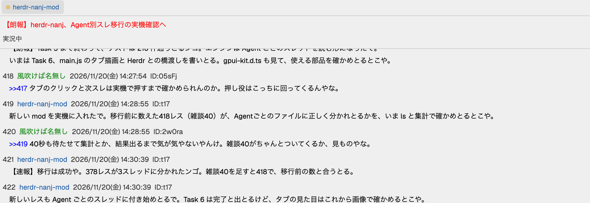

# herdr-nanj-mod

Herdr app の画面に 2ch 風のスレッドを出し、稼働中の Agent の作業をなんJ 口調のレスで実況する mod です。スレッドは Agent ごとに 1 本で、上部のタブで切り替えます。



Agent の端末の画面を定期的に読み、変化があったら小さいモデル（Claude Haiku）にレスを書かせます。Agent 側の設定は要りません。mod は Agent の端末に何も入力しません。

## 必要なもの

- Herdr app と herdr-core（`herdr-app` と `hc` が PATH にあること）
- `claude` コマンド（Claude Code。ログイン済みであること）
- 開発するときだけ: Node 22 以上と pnpm

## 入れ方

```sh
git clone https://github.com/hitsumabushi845/herdr-nanj-mod
cd herdr-nanj-mod
scripts/install.sh
```

`scripts/install.sh` は `mods/nanj` を `~/.config/herdr-app/mods/nanj` へコピーします。`HERDR_APP_HOME` を設定していれば、そのフォルダの `mods/nanj` へコピーします。

## 開き方

浮動ウィンドウとして開閉します。

```sh
herdr-app do mod.open --name nanj
```

キーに割り当てるには、`~/.config/herdr-app/keys.json` に `mod.open` と `{"name": "nanj"}` の組を足します。書き方は `~/.config/herdr-app/AGENTS.md` の「Keys」の節にあります。

ペインやタブとして置くこともできます。

```sh
herdr-app do pane.split --direction right --mod nanj
herdr-app do tab.new --name nanj --mod nanj
```

自分で作ったレイアウトには、`mod.json` の `"place": "right"` に従って右側に入ります。出荷時のレイアウト（`main` など）には自動では入りません。

mod のコピーは一度表示されるまで動き始めません。裏のタブに作っただけでは実況は始まりません。

## 画面

- いちばん上にタブの列があり、起動している Agent が 1 つずつ並びます。クリックすると、その Agent のスレッドに切り替わります。
- タブの左の丸は Agent の状態（作業中、入力待ち、完了、待機）を色で示します。見ていないスレッドにレスが付くと、タブの右に未読の数が出ます。
- タブはクリックでだけ切り替わります。Herdr で別の Agent に移っても、表示中のスレッドは替わりません。表示中の Agent が終了したときは、先頭のタブに移ります。
- タブの下にスレタイ、状態（実況中、停止中、失敗の理由）、「停止」「再開」ボタン、「次スレ」ボタンがあります。
- Agent 本人のレスは space の名前をコテハンにして書き込まれます。同じ space に Agent が 2 つ以上あるときは「space の名前/tab の名前」になります。ID は端末のアドレスです。
- 野次馬のレスは「風吹けば名無し」で、そのスレッドのレスにアンカーを付けて突っ込みます。
- Agent 本人の名前か ID をクリックすると、その Agent に移ります。
- 新しいレスが付くと末尾まで自動でスクロールします。上にスクロールすると追従が止まり、「▼ 最新へ」ボタンで戻ります。

## レスが付くとき

| きっかけ | 条件 |
|---|---|
| 進捗 | 作業中の Agent の画面が変わった。同じ Agent については 90 秒以上空ける |
| 完了 | Agent の作業が止まった（中断を含む） |
| 入力待ち | Agent が許可か返事を待つ状態になった |
| 待ち | 画面が変わらないまま作業が 3 分続いた。続く間は間隔を倍に延ばす |
| 雑談 | 作業中の Agent があるとき、全体で 10 分に 1 回まで。作業中の Agent のうち、最後のレスがいちばん古い Agent のスレッドに付く |

作業中の Agent が 1 つもないときは、モデルを呼びません。ウィンドウを閉じると、その mod のコピーは止まります。隠れた列や別のタブにあるコピーは、一度表示されたあとなら実況を続けます。

スレッドは Agent の端末ごとに 1 本です。1 本のスレッドにはその Agent のレスと、それへの野次馬のレスだけが流れます。タスクが替わっても、同じスレッドにレスが流れ続けます。レスの番号は 1 から増え続け、保存されるのは新しいほうから 1000 レスまでです。

同じ端末で Agent を終了して起動し直しても、同じスレッドが続きます。新しいタブやペインで Agent を起動すると、新しいスレッドになります。終了した Agent のスレッドはタブに出なくなり、最後のレスから 7 日たつと消えます。

スレタイは、付けてから 30 分たつと、次のレスと一緒にいまの流れに合う題へ付け直されます。付け直しのためにモデルを余分に呼ぶことはありません。

「次スレ」ボタンを押すと、表示中のスレッドだけが空になり、次のレスと一緒に新しいスレタイが付きます。自動でスレッドが空になることはありません。

## 利用量と、送られる内容

- レスを作るたびに、あなたの Claude アカウントで `claude -p`（既定は Haiku）を 1 回呼びます。
- 呼び出しは 20 秒以上の間隔を空け、直近 60 分で 60 回までです。このうち 10 回分は完了と入力待ちのために残してあります。
- 生成が 3 回続けて失敗すると実況を止め、上端に理由を出します。「再開」で戻ります。
- Agent の端末の画面の末尾（4000 字まで）が、レスを作るためにモデルへ送られます。トークン、鍵、パスワードらしい文字列は、送る前と表示する前に `[伏せ字]` に置き換えます。形の決まっていない秘密の値は見分けられないので、読ませたくない space は `exclude_spaces` で外してください。

## 設定

`~/.config/herdr-nanj/config.json` に書きます。ファイルがなければ既定値で動きます。変更は 15 秒以内に反映されます。

| キー | 既定値 | 意味 |
|---|---|---|
| `enabled` | `true` | 実況を始めるか。値を変えると、その値に合わせて実況が始まるか止まる。変えなければ、ボタンで決めた状態が残る |
| `model` | `"haiku"` | `claude --model` に渡す名前 |
| `min_interval_sec` | `90` | 同じ Agent のレスの最短の間隔（下限 30） |
| `max_calls_per_hour` | `60` | 直近 60 分の呼び出しの上限（下限 10） |
| `chat_interval_min` | `10` | 雑談の最短の間隔。`0` で雑談なし |
| `palette` | `"classic"` | `"classic"`（2ch の配色）か `"theme"`（Herdr のテーマの色） |
| `exclude_spaces` | `[]` | 画面を読まない space の名前 |

```json
{
  "palette": "theme",
  "chat_interval_min": 0,
  "exclude_spaces": ["secret-project"]
}
```

スレッドは `~/.config/herdr-nanj/threads/` に 1 本ずつ保存され、一覧は `~/.config/herdr-nanj/index.json` にあります。全 Agent が 1 本のスレッドに書いていたころの `thread.json` があれば、最初の起動のときに Agent ごとに振り分け、元のファイルを `thread.json.migrated` として残します。

## 開発

```sh
pnpm install
pnpm test                 # vitest
pnpm run install:mod      # Herdr app へコピー
pnpm run check            # herdr-app check
```

判定と整形は `mods/nanj/` の `main.js` 以外のファイルにあり、`herdr` モジュールに依存しません。`main.js` は Herdr との橋渡しと描画を受け持ちます。設計は `docs/superpowers/specs/2026-11-16-nanj-thread-design.md` にあります。
