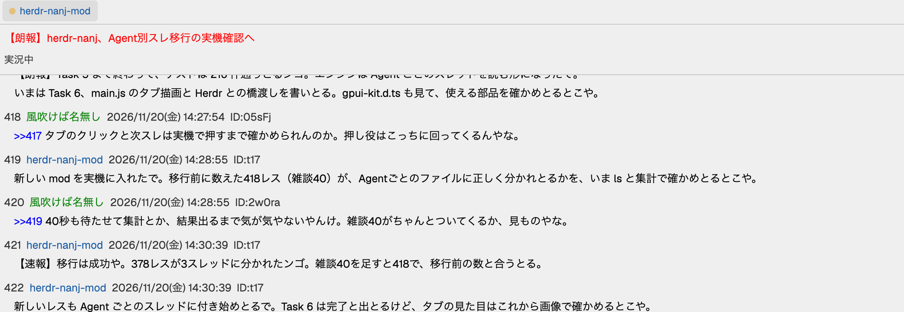

# なんJ 実況スレ

Herdr app の画面に 2ch 風のスレッドが出て、稼働中のコーディング Agent が進捗、発見、感想をなんJ 口調のレスで書き込む。野次馬の名無しがアンカーを付けて突っ込む。スレッドは Agent ごとに 1 本で、上部のタブで切り替える。Agent の待ち時間を、実況として眺めるための mod。

## 何が見えるか

上から順に 4 つの領域がある。

1. タブの列（高さ 32 px、横にスクロールする）。起動している Agent が `agents()` の順に 1 つずつ並ぶ。タブは 8 px の丸（状態の色。`theme()` の `working`、`blocked`、`done`、`idle`）、Agent の名前（12 px、スレッドの色。選ばれているタブは太字で背景付き）、未読が 1 以上のときだけ未読の数（赤い丸の中に 11 px の数字）。起動している Agent が 1 つもなければ、タブの列の代わりに「起動している Agent がありません」と出す。
2. スレタイの帯。1 行目に赤い太字のスレタイ（決まるまでは「スレ立て待ち」）。2 行目の左に状態（「実況中」「停止中」、失敗したときは赤字の理由）、右に「停止」か「再開」、「次スレ」、浮動ウィンドウのときだけ「×」のボタン。下に 1 px の線。
3. レスの一覧。縦にスクロールする。1 レスは 2 段で、上の段に番号、名前（太字）、時刻（`2026/11/16(月) 19:32:10`）、`ID:<id>`、下の段に 12 px 字下げした本文。レスの間は 8 px。
4. 追従を止めているときだけ、下端に「▼ 最新へ」ボタン。

文字は 13 px。配色は `palette` で決まる。

- `classic`: 背景 `#efefef`、本文 `#000000`、番号と時刻と ID `#333333`、野次馬の名前 `#008000`、スレタイ `#ff0000`、アンカー `#0000ff`、線 `#c8c8c8`、ボタン `#dddddd`。Agent の名前は `#1e5fa8`、`#b22222`、`#8b5a00`、`#6a1b9a`、`#00695c`、`#ad1457`、`#37474f`、`#5d4037` の 8 色。
- `theme`: `theme()` の `surface`、`foreground`、`muted`、`done`、`blocked`、`accent`、`border`、`raised`。Agent の名前は `ansi1` から `ansi6`、`ansi9`、`ansi12`。

Agent 本人の名前は space の名前で、同じ space に Agent が 2 つ以上あれば「space の名前/tab の名前」。24 字で切る。ID は端末のアドレス。Agent ごとの色はスレッドを作った順に 8 色を割り当て、タブの名前にも同じ色を使う。野次馬の名前は「風吹けば名無し」、ID は英数字 5 字。

## どう動くか

15 秒ごとに `agents()` を見て、きっかけがあればレスを 1 件から 3 件作る。

- `working`: 画面を `hc read <端末> --lines 40` で読む。前にレスを作ったときから画面が変わっていて、その Agent の前のレスから 90 秒以上たっていれば「進捗」。画面が変わらないまま 3 分たてば「待ち」。待ちが続く間は、間隔を 6 分、12 分と倍にする。
- `working` から `done` か `idle` に変わった: 「完了」。進捗より先に処理する。
- `blocked` に変わった: 「入力待ち」。進捗より先に処理する。
- `idle`: 何もしない。作業中の Agent が 1 つもなければ、モデルを呼ばない。
- 作業中の Agent があるとき、全体で 10 分に 1 回まで「雑談」。作業中の Agent のうち最後のレスがいちばん古い Agent のスレッドに、野次馬だけが書く。

画面が変わったかどうかは、スピナー、経過時間、トークン数、入力欄、状態の行を除いた末尾 30 行のハッシュで比べる。

モデルの呼び出しは同時に 1 つ、20 秒以上の間隔、直近 60 分で 60 回まで。進捗、待ち、雑談は 50 回で止まり、残りの 10 回は完了と入力待ちに使う。失敗したきっかけは捨てる。3 回続けて失敗したら止まり、理由を上端に出す。

スレッドは Agent の端末ごとに 1 本で、キーは `<端末のアドレス>@<created_ms>`。1 本のスレッドにはその Agent のレスと、それへの野次馬のレスだけを入れる。モデルに渡す直近のレスも、そのスレッドのものだけ。タスクが替わっても同じスレッドに流れ続け、自動では新しくならない。同じ端末で Agent を起動し直しても、同じスレッドが続く。起動していない Agent のスレッドはタブに出さず、最後のレスから 7 日たったら消す。レスの番号は 1 から増え続け、1000 レスを超えたら古いレスから落とす。新しくなるのは「次スレ」を押したときだけ。最初のレスと一緒にモデルがスレタイを付ける。付けてから 30 分たったら、次のレスと一緒に、今のスレタイを伝えて付け直しを頼む。応答にスレタイがなければ今のスレタイを残し、次のレスでまた頼む。

クリックと操作:

- Agent 本人の名前か ID: `agent.focus {terminal}` でその Agent に移る。
- 「停止」「再開」: 実況を止める、戻す。再開は失敗の理由も消す。
- タブ: そのスレッドに切り替える。切り替わるのはクリックのときと、表示中の Agent が終了したとき（先頭のタブに移る）だけ。Herdr で別の Agent に移っても切り替えない。
- 「次スレ」: 表示中のスレッドだけを空にする。
- 上へのホイール: 末尾への追従を止める。「▼ 最新へ」で戻る。
- 「×」: 浮動ウィンドウを閉じる。

動くものはない（アニメーションなし）。

## 何で作ったか

`mods/nanj/` の 11 ファイル。`main.js` 以外は `herdr` を import しない純粋なモジュールで、Node 上でテストできる。

- `mod.json`: `{ "place": "right", "size": 380, "title": "なんJ", "overlay": { "kind": "window", "key": "nanj", "keep": true, "width": 440, "height": 620 } }`
- `config.js`: 設定の既定値と検証。
- `names.js`: コテハンと野次馬の ID。
- `screen.js`: 画面の末尾の切り出し、変化の判定、認証情報の伏せ字。
- `budget.js`: 呼び出しの上限。
- `triggers.js`: きっかけの状態と選択。
- `thread.js`: スレッドのデータ、キー、一覧、時刻の書式、アンカーの分割、保存の形、1 本のスレッドからの移行。
- `tabs.js`: タブの並び、選択、未読の計算。
- `prompt.js`: システムプロンプト、入力の組み立て、応答の検証。
- `claude.js`: `claude` の引数と応答の取り出し。
- `engine.js`: 1 回分の処理（観測、きっかけの選択、生成、保存）と、生成役のリース。
- `main.js`: `herdr` との橋渡しと描画。

`herdr` から使う関数: `agents`、`hc`、`exec`、`home`、`checking`、`readTextFile`、`writeTextFile`、`shared`、`setShared`、`run`、`theme`、`props`、`closeOverlay`。コマンドは `agent.focus` だけ。

実行するプログラム:

- `hc read <端末> --lines 40`
- `hc get <端末> --json`（`created_ms` を読む。端末ごとに 1 回）
- `mkdir -p ~/.config/herdr-nanj/threads`
- `rm -f ~/.config/herdr-nanj/threads/<キー>.json`（7 日たったスレッド）
- `mv thread.json thread.json.migrated`（移行のあと、1 回だけ）
- `claude -p --model <model> --tools "" --strict-mcp-config --setting-sources "" --no-session-persistence --output-format json --system-prompt <system> --json-schema <schema> -- <user>`（`~/.config/herdr-nanj` で実行、タイムアウト 60 秒）

この mod は `claude` を通じてネットワークに出る。mod のフォルダの外では `~/.config/herdr-nanj/config.json` を読み、`~/.config/herdr-nanj/threads/<キー>.json`（スレッド 1 本ずつ）と `~/.config/herdr-nanj/index.json`（一覧）を読み書きする。1 ファイルにまとめないのは、`readTextFile` が 1 MiB までしか読めないため。`shared` には `nanj.leader`、`nanj.rev`（変わったスレッドのキーと版）、`nanj.paused`、`nanj.enabled`、`nanj.error`、`nanj.rotate`（次スレにするキーと時刻）、`nanj.tab`（選んだスレッドのキー）、`nanj.seen`（キーごとの、最後に見たレス番号）を置く。

モデルへの入力はきっかけの種類、Agent の名前と ID と space と tab、次のレスの番号、直近のレス 10 件、伏せ字にした画面の末尾 4000 字。出力は `{"title"?: string, "posts": [{"who": "agent" | "yajiuma", "body": string}]}`。本文は 3 行と 200 字で切り、スレタイは 40 字で切る。

## 注意

- mod は Agent の端末に入力を送らない。`hc send`、`hc keys`、`hc interrupt`、`terminal.paste` を使わない。
- 出荷時のレイアウトには `"place": "right"` で自動では入らない。`mod.open` の浮動ウィンドウ、`pane.split {mod}`、`tab.new {mod}` で置く。
- mod のコピーは一度表示されるまで始まらない。`tab.new {focus: false}` で作っただけのコピーは動かない。
- コピーが 2 つ以上動くときは、`shared("nanj.leader")` の `{id, at}` を 45 秒のリースとして、生成するコピーを 1 つに絞る。生成役を引き継いだコピーは生成の前に必ず、一覧と手元のスレッドをすべて読み直す。読み直さないと、手元の古いスレッドで新しいレスを上書きする。
- 生成役でないコピーは 3 秒ごとに `shared("nanj.rev")` を比べ、変わっていたら読み直す。`render` の中で始めた非同期の処理には頼らない。
- `writeTextFile` が古い内容との不一致で失敗したら、上書きせず、保存されている内容を読み直す。
- 画面は伏せ字にしてから末尾を切る。先に切ると、秘密鍵の見出しが落ちて中身が残る。
- 今のスクロールの位置を読む API はない。追従を止める判定は `on_scroll_wheel` の `delta.y > 0` で行う。
- 色の違う文字列は `h_flex().flex_wrap()` に `div` を並べて描くので、アンカーのあとの長い本文は次の行から始まる。
- 描くのは新しいほうから 200 レスまで。保存は新しいほうから 1000 レスまで。
- 端末の作成時刻（`created_ms`）は `agents()` にない。`hc get` で読めるまで、その Agent のスレッドもレスも作らない。作成時刻なしでキーを作ると、アドレスが使い回されたときに別の Agent の話が混ざる。
- 横スクロールの列は高さを決める。決めないと縦いっぱいに広がり、下の領域が押し出される。
- 起動していないことだけを理由にスレッドを消さない。`agents()` が一時的に空を返すことがある。
- `render` の中で `setShared` を呼ばない。タブの選択と既読の位置は、タイマーの中で反映する。
- 時間の空きやレスの数でスレッドを自動で替えない。タスクの切れ目ごとにスレッドが替わり、流れが途切れる。
- `claude --bare` は API キーでの認証を前提にするので使わない。
- `-` で始まる画面の内容を引数と取り違えないよう、本文の前に `--` を置く。
- ボタンは `on_mouse_down` で伝播を止める。止めないと、浮動ウィンドウのドラッグが始まる。

## 完成の条件

- `herdr-app check <mod のフォルダ>` が通る。
- 作業中の Agent が 1 つある状態で `herdr-app do mod.open --name nanj` を実行すると、30 秒以内にスレタイと最初のレスが付く。
- Agent の画面を 3 分以上止めると、待ちのレスが付く。
- コピーを 2 つ表示しても、同じきっかけでレスが 2 重に付かない。
- Agent を 2 つ動かすと、タブが 2 つ並び、それぞれのスレッドのファイルに入る Agent 本人のレスが 1 つの端末のものだけである。
- 選んでいないスレッドにレスが付くと、タブに未読の数が出る。
- 作業中の Agent がない状態を 30 分以上はさんでも、次のレスが同じスレッドに続きの番号で付く。
- 生成役のコピーを閉じると、残りのコピーが 1 分以内に実況を続け、それまでのレスが残り、番号が 1 からの連番のままである。
- 作業中の Agent がないとき、`claude` のプロセスが起動しない。
- 実況中の Agent の端末に、mod からの入力がない。
